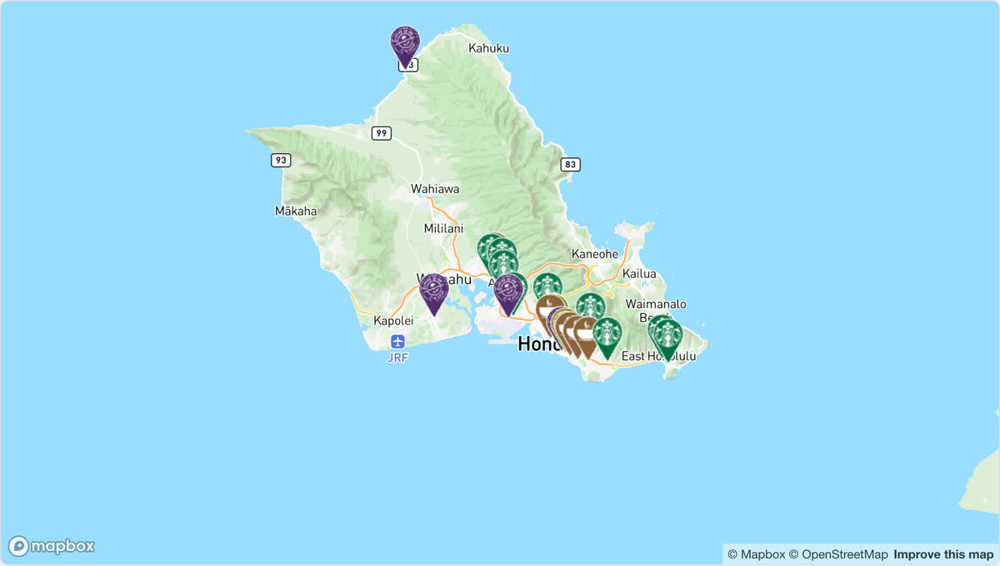

# @mapconductor/reactnative-for-mapbox

MapConductor の Mapbox 用 React Native プロバイダーです。Web 用の
`@mapconductor/react-for-mapbox` とは別パッケージで、Android の
`com.mapconductor:for-mapbox` と iOS の `MapConductorForMapbox` を薄くラップします。

## デモ

[](https://demo-react.mapconductor.com/mapbox/map/en)

画像は Web 版（[`@mapconductor/react-for-mapbox`](https://github.com/MapConductor/react-for-mapbox)）の[ライブデモ](https://demo-react.mapconductor.com/mapbox/map/en)です。同じ店舗マップを React Native で書くと次のとおりです。

```tsx
import { useMemo, useState } from 'react';
import { Text } from 'react-native';
import {
  createGeoPoint,
  createMapCameraPosition,
  createMarkerState,
  type MarkerState,
} from '@mapconductor/js-sdk-core';
import { InfoBubble, Markers } from '@mapconductor/js-sdk-react/native';
import { MapboxDesign, MapboxMapView, useMapboxViewState } from '@mapconductor/reactnative-for-mapbox';

const STORES = [
  { id: 'waikiki', name: 'Waikiki', latitude: 21.2793, longitude: -157.8292 },
  { id: 'kailua', name: 'Kailua', latitude: 21.3972, longitude: -157.7394 },
  { id: 'haleiwa', name: 'Haleiwa', latitude: 21.5928, longitude: -158.1034 },
];

const INITIAL_CAMERA = createMapCameraPosition({
  position: createGeoPoint({ latitude: 21.38, longitude: -157.93 }),
  zoom: 10,
});

export function StoreMap() {
  const mapViewState = useMapboxViewState({
    mapDesignType: MapboxDesign.Streets,
    cameraPosition: INITIAL_CAMERA,
  });
  const [selected, setSelected] = useState<MarkerState | null>(null);
  const markers = useMemo(
    () =>
      STORES.map(store =>
        createMarkerState({
          id: store.id,
          position: createGeoPoint({ latitude: store.latitude, longitude: store.longitude }),
          extra: store,
          onClick: marker => setSelected(marker),
        }),
      ),
    [],
  );

  return (
    <MapboxMapView state={mapViewState} style={{ flex: 1 }} onMapClick={() => setSelected(null)}>
      <Markers states={markers} />
      {selected && (
        <InfoBubble marker={selected}>
          <Text>{(selected.extra as (typeof STORES)[number]).name}</Text>
        </InfoBubble>
      )}
    </MapboxMapView>
  );
}
```

## 使い方

```tsx
import {
  MapboxDesign,
  MapboxMapView,
  useMapboxViewState,
} from '@mapconductor/reactnative-for-mapbox';

export function MapPage() {
  const state = useMapboxViewState({
    id: 'main-map',
    mapDesignType: MapboxDesign.Streets,
  });

  return <MapboxMapView state={state} style={{ flex: 1 }} />;
}
```

通常のオーバーレイは `@mapconductor/js-sdk-react` の `Marker`、`Markers`、
`Polyline`、`Polygon`、`Circle`、`GroundImage`、`RasterLayer` を子として宣言します。
大量のマーカーには、1 マーカーごとの React effect を作らない `Markers` を使用してください。

## ★ デザインは id ではなく「スタイル URI」で渡している

**Mapbox だけ `id` が 3 プラットフォームで揃っていません。**

| | `id` | `getValue()` |
|---|---|---|
| web | `streets` | `mapDesign_id=streets,style=mapbox://styles/mapbox/streets-v12`（**合成形**） |
| android / iOS | `streets-v12` | `mapbox://styles/mapbox/streets-v12` |

3 つを貫く実体は**スタイル URI だけ**なので、RN は web の `styleJsonURL` を送り、
ネイティブは受け取った URI をそのまま `loadStyle` / `styleURI` へ流します。
`getValue()` を送ると android で
`Failed to parse style: Invalid value. at offset 0` になり地図が真っ白になります（実機で踏みました）。

**MapTiler / Longdo は id を渡しています。あちらを写経しないでください。**

## ネイティブ設定

- Android: MavenLocal の `com.mapconductor:for-mapbox:1.2.0` と Mapbox の Maven
  リポジトリ（`https://api.mapbox.com/downloads/v2/releases/maven`、v11 は認証不要）が
  必要です。公開アクセストークンは application manifest の `MAPBOX_ACCESS_TOKEN`
  meta-data へ設定します。**未設定だと `MapboxInitSDK` が例外を投げて落ちます。**
- iOS: `MapConductorForMapbox` を CocoaPods で解決します。ベンダの `MapboxMaps` は
  trunk にあり、その依存（`MapboxCoreMaps` / `MapboxCommon`）は Mapbox の CDN から
  降りてきます（Maps SDK v11 はダウンロードトークン不要）。アクセストークンは
  Info.plist の `MBXAccessToken` へ設定します。値に `$(...)` が残っていれば
  未展開のビルド設定プレースホルダとして弾きます（弾かないとタイルが 401 になり、
  「真っ白」という原因の分かりにくい形でしか出ません）。

トークンは環境変数、Gradle property、または git 管理外の設定ファイルから注入し、
リポジトリへコミットしないでください。

## 開発時の確認

```bash
npm run build --workspace @mapconductor/reactnative-for-mapbox

# android-for-mapbox を変更したら publishToMavenLocal が必須
env JAVA_HOME="/Applications/Android Studio.app/Contents/jbr/Contents/Home" \
  ./gradlew :android-for-mapbox:publishToMavenLocal
```

コントローラの組み立ては android / iOS とも**1 か所に閉じて**あります
（`createMapboxViewController()` / `MapboxMapHost.makeMapView()`）。Compose / SwiftUI 版と
まったく同じ入口を通るので、RN 側でコントローラを組み直さないでください。

クリックのカスケードと座標投影は各ネイティブドライバー側の責務です。
RN 層で別の当たり判定や投影を書かないでください。
